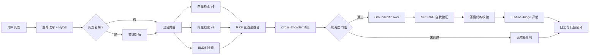

# OfficeMate

OfficeMate 是一个面向企业内部制度与流程的 **RAG 多智能体知识助手**。系统支持多格式文档入库、语义+规则混合路由、查询改写与分解、三通道混合检索（向量+向量+BM25）、Cross-Encoder 精排、Self-RAG 自我验证、LLM-as-Judge 多维评估和反馈闭环，重点解决企业知识问答中"检索不准、回答无依据、来源不可追溯"的问题。

> 项目最初参考黑马程序员 RAG 案例，当前版本已围绕检索质量、工作流编排、工程安全、可测试性和可部署性进行了重新设计，并引入语义路由、查询分解、多 Embedding 融合、动态切分、LangGraph 工作流和 LLM-as-Judge 评估。

---

## 系统架构



### 核心智能体

| 智能体 | 文件 | 职责 |
|--------|------|------|
| `DomainRouterAgent` | `agents/router.py` | 规则路由：关键词匹配 + tie-breaking，零 Token 消耗 |
| `SemanticRouterAgent` | `agents/semantic_router.py` | 语义路由：Embedding 余弦相似度 + 规则加权融合 |
| `GroundedAnswerAgent` | `agents/answer_agent.py` | 依据回答：只从编号材料中生成，固定三段式结构 |
| `SelfRAGRefiner` | `agents/self_rag.py` | 自我验证：模型检查引用依据，标记无依据内容 |
| `AnswerVerifierAgent` | `agents/verifier.py` | 结构校验：检查章节、引用编号、无依据拒答 |

### 编排方式

- **传统管线**：`OfficeMateChatService._answer_legacy()` — 线性编排，适合单次调用
- **LangGraph 工作流**：`agents/workflow.py` — StateGraph 状态图，支持条件分支（Self-RAG 不通过→重试）、失败重试、检查点恢复

---

## 核心能力

### 1. 混合路由：规则 + 语义

- **规则路由**（`DomainRouterAgent`）：6 个领域 × 专业关键词表，按匹配数量和关键词长度排序，零 Token
- **语义路由**（`SemanticRouterAgent`）：Embedding 编码问题与领域描述，余弦相似度分类，与规则加权融合（语义 0.6 + 规则 0.4）
- **LLM fallback**：低置信度时可切换到 LLM 判定

### 2. 查询优化：改写 + HyDE + 分解

- **查询改写**（`QueryRewriter`）：口语→书面语规范化，生成多角度查询变体
- **HyDE**（`QueryRewriter.hyde_embed`）：生成假设文档片段，提升向量检索召回率
- **查询分解**（`QueryDecomposer`）：复杂问题（如"年假怎么请、病假需要什么材料"）拆分为独立子查询，分别检索后合并

### 3. 三通道混合检索 + 两级重排

```
查询 → 向量检索v1(DashScope v4) ──┐
     → 向量检索v2(BGE) ───────────┼─ RRF 三通道融合 ── Cross-Encoder 精排 ── 相关度门槛
     → BM25(jieba分词) ───────────┘
```

- **语义分块**（`SemanticChunker`）：标题层级感知，按文档类型自适应切分（fine/coarse/default）
- **RRF 粗排**：三通道加权融合，可配置各通道权重
- **Cross-Encoder 精排**（BGE-Reranker）：粗排候选上做语义重排，比 Bi-Encoder 更准确

### 4. 有依据回答与主动拒答

回答固定包含三段式结构：
- `### 最终回答` — 结论，关键处标注 `[1]` 引用编号
- `### 操作步骤/材料清单` — 逐步操作或材料列表
- `### 风险提示` — 潜在风险和建议

无依据时直接拒答，不调用大模型强行生成。

### 5. Self-RAG 自我验证

答案生成后，模型自动检查每个关键结论（数字、时限、审批人）是否有引用依据，对无依据内容添加风险提示。

### 6. LLM-as-Judge 多维评估

四维度语义评估（`evaluation/llm_judge.py`）：

| 维度 | 权重 | 评估内容 |
|------|------|---------|
| Faithfulness | 0.35 | 答案是否严格基于引用，有无幻觉 |
| Relevance | 0.30 | 答案是否直接回答用户问题 |
| Format | 0.15 | 三段式结构、引用编号是否正确 |
| Completeness | 0.20 | 是否遗漏关键信息（金额、时限、审批人） |

### 7. 知识全生命周期

- 支持 `txt`、`pdf`、`docx`、`xlsx`、`csv`
- 文档 SHA-256 去重
- 文档分类、标题、版本和来源管理
- 删除文档时同步清理原文件、向量索引和 BM25 索引
- 文件名安全处理，避免路径穿越
- 上传内容提示注入扫描，高风险文档阻断入库并保留审计记录
- 内置 6 类示例制度文档

### 8. 工程可靠性

- 密钥只从环境变量读取，仓库不保存凭证
- 检索材料被明确视为数据而非指令，入库前拦截常见中英文提示注入模式
- JSON 元数据采用临时文件 + 原子替换
- 读改写全过程加锁，避免并发覆盖
- 检索失败抛出明确业务异常
- 核心组件支持依赖注入，可离线单元测试
- Docker 部署配置

---

## 项目结构

```text
OfficeMate/
├─ agents/                    # 智能体实现
│  ├─ router.py               # 规则路由：DomainRouterAgent（关键词匹配 + tie-breaking）
│  ├─ semantic_router.py      # 语义路由：SemanticRouterAgent（Embedding + 规则融合）
│  ├─ answer_agent.py         # 依据回答：GroundedAnswerAgent（三段式结构化输出）
│  ├─ verifier.py             # 结构校验：AnswerVerifierAgent（章节/引用/拒答检查）
│  ├─ self_rag.py             # 自我验证：SelfRAGRefiner（引用依据自动检查）
│  └─ workflow.py             # LangGraph 工作流：状态图编排，支持重试和检查点
├─ evaluation/                # 评估体系
│  ├─ evaluate_retrieval.py   # 评估脚本：lexical / hybrid / judge / all 四种模式
│  ├─ cases.json              # 评测用例：21 条，覆盖 6 个领域 + 拒答场景
│  └─ llm_judge.py            # LLM-as-Judge：四维度语义评估（忠实度/相关度/格式/完整性）
├─ pages/                     # Streamlit 多页面入口
│  ├─ 1_知识上传.py           # 文档上传与管理页面
│  └─ 2_知识管理.py           # 知识库管理与统计页面
├─ sample_docs/               # 可直接导入的企业制度样例（6 个文件）
├─ services/                  # 服务层
│  ├─ chat_service.py         # 问答编排：OfficeMateChatService（传统管线 + LangGraph 双模式）
│  ├─ document_service.py     # 文档服务：DocumentService（解析/入库/去重/安全扫描/删除）
│  ├─ document_parser.py      # 文档解析：支持 txt/pdf/docx/xlsx/csv
│  ├─ vector_store.py         # 向量存储：OfficeMateVectorStore（三通道 RRF 融合 + Cross-Encoder 精排）
│  ├─ semantic_chunker.py     # 语义分块：SemanticChunker（标题感知 + 动态策略）
│  ├─ lexical_index.py        # BM25 索引：BM25LexicalIndex（持久化 JSON，线程安全）
│  ├─ reranker.py             # 精排器：CrossEncoderReranker（BGE-Reranker）
│  ├─ query_rewriter.py       # 查询改写：QueryRewriter（规范化 + HyDE）
│  ├─ query_decomposer.py     # 查询分解：QueryDecomposer（复杂问题拆子查询）
│  ├─ text_analyzer.py        # 文本分析：jieba 分词 + 停用词表 + n-gram
│  ├─ content_security.py     # 内容安全：DocumentSecurityScanner（提示注入扫描）
│  ├─ storage_service.py      # 存储服务：JsonStorageService（原子化 JSON，读写锁）
│  ├─ ui_pages.py             # UI 页面：Streamlit 聊天/上传/管理页面渲染
│  └─ exceptions.py           # 异常定义：OfficeMateError / RetrievalError / StorageError
├─ tests/                     # 离线单元测试（25 条，无需 API Key）
│  ├─ test_router.py          # 路由测试（4 条）
│  ├─ test_chat_workflow.py   # 工作流测试（3 条：完整流程/拒答/回退）
│  ├─ test_content_security.py # 安全测试（3 条：正常/注入/阻断）
│  ├─ test_lexical_index.py   # BM25 测试（5 条：检索/过滤/IDF/空结果/删除）
│  ├─ test_vector_scoring.py  # 评分测试（4 条：覆盖度/RRF/距离拒绝）
│  ├─ test_storage.py         # 存储测试（3 条：增删改/损坏/统计）
│  └─ test_verifier.py        # 校验测试（3 条：缺章节/拒答/通过）
├─ app.py                     # 应用入口（Streamlit 主页面）
├─ app_file_uploader.py       # 上传页面入口
├─ app_qa.py                  # 问答页面入口
├─ config_data.py             # 环境驱动配置（30+ 配置项，全部从环境变量读取）
├─ Dockerfile                 # Docker 镜像定义
├─ requirements.txt           # 生产依赖
├─ requirements-dev.txt       # 开发依赖（pytest + ruff）
└─ pyproject.toml             # 工具配置（pytest / ruff）
```

---

## 技术栈

- Python 3.12 / 3.10
- Streamlit（UI）
- LangChain / LangGraph（编排）
- ChromaDB（向量存储）
- DashScope Embedding / Qwen（向量化 + 对话）
- BGE-Reranker（Cross-Encoder 精排）
- jieba（中文分词）
- Pandas、PyPDF、python-docx、openpyxl（文档解析）
- unittest / pytest、Ruff、Docker

---

## 快速开始

### 1. 创建环境并安装依赖

```powershell
python -m venv .venv
.\.venv\Scripts\Activate.ps1
pip install -r requirements.txt
```

开发和测试环境：

```powershell
pip install -r requirements-dev.txt
```

### 2. 配置密钥

参考 `.env.example`，通过系统环境变量提供密钥：

```powershell
$env:DASHSCOPE_API_KEY="your_new_api_key"
```

不要将真实密钥写入 `config_data.py`、README 或 Git 提交。

### 3. 启动应用

```powershell
streamlit run app.py
```

打开知识上传页，点击"一键导入示例文档"，即可体验完整问答流程。

---

## 测试与评估

### 单元测试（离线，无需密钥）

```powershell
python -m unittest discover -s tests -v
```

### 检索评估

```powershell
# BM25 离线评估
python -m evaluation.evaluate_retrieval --mode lexical

# 向量 + BM25 + RRF 评估（需要 API Key）
python -m evaluation.evaluate_retrieval --mode hybrid
```

### LLM-as-Judge 语义评估（需要 API Key）

```powershell
# 单独运行语义评估
python -m evaluation.evaluate_retrieval --mode judge

# 完整评估：检索 + 答案质量
python -m evaluation.evaluate_retrieval --mode all
```

### 评估指标

| 模式 | 输出指标 |
|------|---------|
| lexical / hybrid | Route accuracy、Hit@K、MRR、Abstention accuracy |
| judge / all | + Faithfulness、Relevance、Format、Completeness（1-5 分）、Overall（0-1） |

### 当前评估结果

```
Lexical Retrieval Evaluation (21 cases):
  Route accuracy  : 100.0%
  Hit@K           : 100.0%
  MRR             : 1.000
  Abstention acc. : 100.0%
```

---

## Docker 运行

```powershell
docker build -t officemate .
docker run --rm -p 8501:8501 -e DASHSCOPE_API_KEY="your_new_api_key" officemate
```

生产环境需要为 `storage/` 挂载持久卷。

---

## 可用于简历的项目描述

- 设计并实现企业制度 RAG 多智能体助手，构建 **查询改写 → 混合路由 → 查询分解 → 三通道检索 → Cross-Encoder 精排 → Self-RAG → LLM-as-Judge** 的完整闭环工作流
- 实现 **规则 + Embedding 混合路由**：关键词匹配与语义相似度加权融合，领域路由准确率 100%
- 实现 **RRF 粗排 + Cross-Encoder 精排** 两级重排架构，Hit@K 100%、MRR 1.000
- 设计 **标题层级感知的语义切分策略**，按文档类型自适应调整 chunk_size
- 引入 **LLM 驱动的查询改写、HyDE 和查询分解**，提升口语化查询和复杂问题的召回率
- 基于 **jieba 分词 + 完整停用词表** 重构 BM25 索引，针对中文制度文档深度优化
- 实现 **Self-RAG 自我验证** 和 **LLM-as-Judge 四维评估**（忠实度/相关度/格式/完整性），降低幻觉风险
- 使用 **LangGraph StateGraph** 替代硬编码编排，支持条件分支、失败重试和检查点恢复
- 支持多 Embedding 融合（DashScope v4 + BGE），三通道 RRF 加权融合
- 实现带原文片段的可追溯引用和无依据拒答，记录路由置信度、检索得分、校验结果与用户反馈
- 增加知识库提示注入扫描与阻断审计
- 完成环境变量密钥管理、原子化本地存储、依赖注入、离线单元测试及 Docker 部署配置

---

## 后续演进

- **PostgreSQL + Redis**：支持多实例部署、会话缓存和可靠并发
- **JWT / SSO + RBAC**：实现用户、部门和文档级权限
- **OCR 与表格结构化抽取**：覆盖扫描 PDF 和复杂制度附件
- **多智能体辩论**：多个回答智能体从不同角度生成答案，由裁判智能体汇总
- **ReAct 工具调用**：让回答智能体动态调用检索工具，而非接收预构建上下文
- **CI/CD 与线上评测**：自动执行测试、镜像构建和 RAG 回归评估
- **领域自适应 Fine-tuning**：针对企业制度文档微调 Embedding 模型和 Cross-Encoder